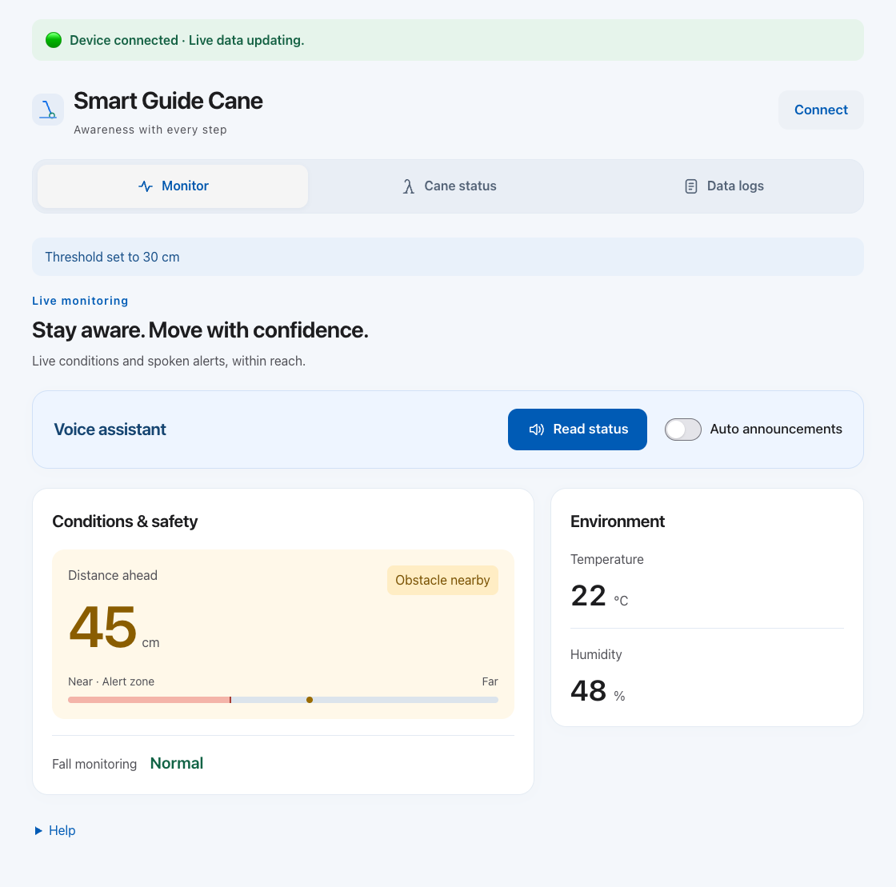
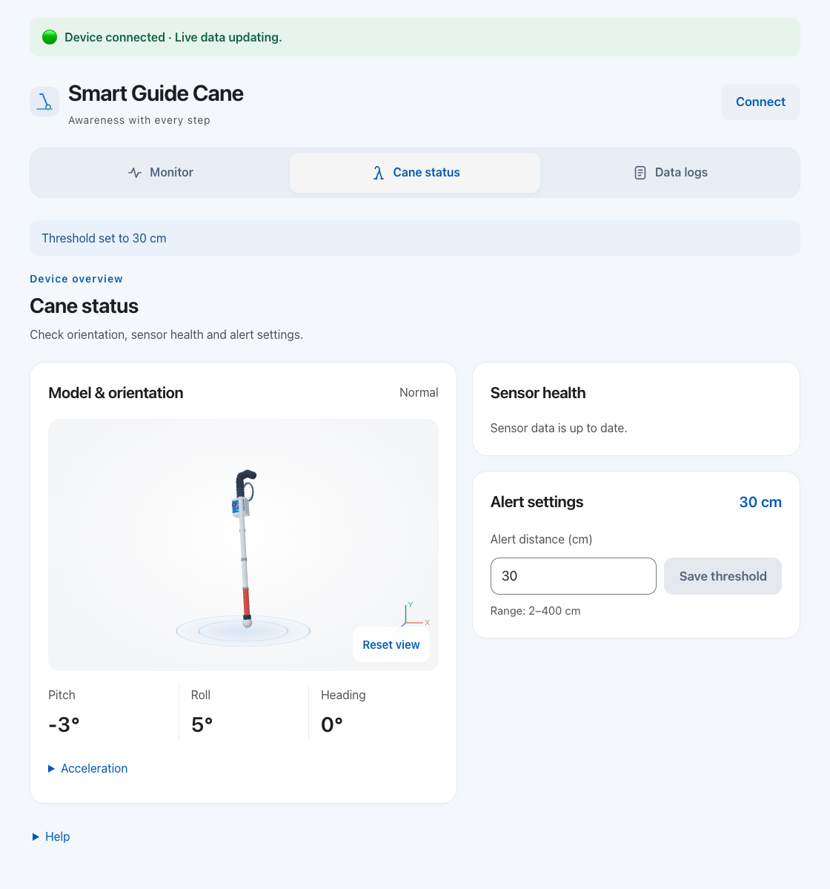
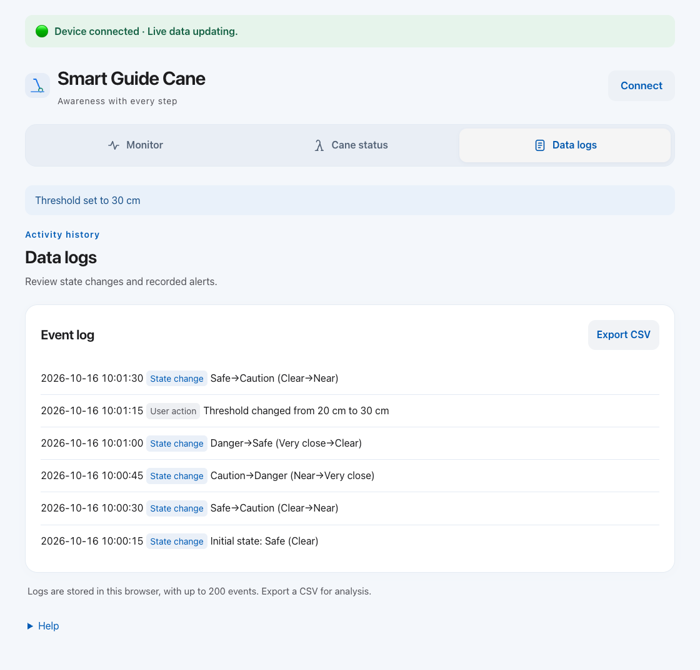

# Smart Guide Cane

## Overview

This project develops an ESP32-based guide cane prototype that combines obstacle sensing, multimodal feedback and a browser-based monitoring interface. It provides a platform for investigating supplementary information for blind and partially sighted users.

The current implementation supports distance-based alerts, sensor monitoring, optional spoken summaries and event recording. The project remains at the prototype stage; its effectiveness during mobility tasks has yet to be established through physical testing and user evaluation.

## Learning log and demonstration

- [ESP32 smart cane learning log — 10–16 October 2026](docs/learning/2026-10-10-to-2026-10-16-esp32-smart-cane-learning-log.md): development notes, test observations and proposed next steps, written in British English. This is a historical record of that learning period.
- [Watch or download the prototype demonstration](docs/videos/smart-cane-prototype-demo.mp4?raw=true): approximately 1 minute 18 seconds (14.3 MB). The recording illustrates the prototype; it does not establish sensing accuracy or effectiveness during mobility tasks.

## System design

The system follows a simple information flow:

**Sensor acquisition → signal processing → state classification → feedback and monitoring → event recording**

| Component | Current function |
| --- | --- |
| ESP32 | Sensor acquisition and hardware feedback control |
| HC-SR04 | Ultrasonic distance measurement |
| Fall sensor | Debounced digital posture indication |
| MPU6050 | Acceleration and angular velocity for the displayed orientation |
| DHT11 | Temperature and relative humidity measurement |
| Motor, buzzer and LED ring | Tactile, audible and visual feedback |
| OLED | Local display of distance, state and threshold |

The browser receives serial messages at 115200 baud. Hardware alerts run on the ESP32, while spoken announcements and event storage run in the browser.

## Alert logic

Distance measurements are processed in batches of five using the median. A new batch starts approximately every 0.5 seconds. Three consecutive valid results confirm entry into an obstacle alert band. Separate exit boundaries provide hysteresis to limit repeated switching near a threshold.

The default threshold, *T*, is 20 cm and can be adjusted between 2 and 400 cm. Restarting the device restores the default.

| State | Entry condition | Feedback |
| --- | --- | --- |
| Very close | Three results below *T* | Red ring; two short beeps and vibrations |
| Near | Three results below min(2*T*, 400 cm); Very close takes priority | Yellow ring; one short beep and vibration |
| Normal | No confirmed obstacle alert remains active | Green ring; no obstacle beep or vibration |
| Invalid range | No valid range measurement in the current result | Periodic long beep and white flash; no vibration |

A fall indication triggers three short vibrations only while the distance state is Normal. Distance alerts take priority. Temperature, humidity and MPU6050 readings do not trigger the hardware actuators.

## Browser interface

The three views are shown below. Mobile layouts use bottom navigation. Keyboard controls, screen-reader labels and reduced-motion support are included.

**All figures use simulated readings and illustrative event times. They are software demonstrations, not results from a physical experiment.**

### Monitoring

The monitoring view presents distance, fall status and environmental readings. Speech controls appear at the top. English text-to-speech uses the browser SpeechSynthesis API; optional automatic announcements respond to state changes rather than every numerical update.

*Figure 1. Monitoring view showing a confirmed nearby obstacle and speech controls.*

### Cane status

This view combines an illustrative 3D model, estimated orientation, sensor health and threshold settings. Heading is relative and subject to drift because the MPU6050 has no magnetometer.

*Figure 2. Model, orientation and sensor health display.*

### Data logs

Logs record distance-state changes, measurement failures and recovery, fall events and threshold changes. Up to 200 events are stored locally. CSV export includes an **Observed outcome** field for subsequent evaluation. Timestamps represent reception by the computer.

*Figure 3. Illustrative event history, including a threshold adjustment.*

## Validation and next steps

The firmware has compiled successfully for the configured ESP32 board. Browser checks with simulated serial data and speech have verified navigation, state transitions, logging and layouts at six widths between 320 and 1280 pixels. Actual audio output, physical phone compatibility and real-world sensing performance remain unverified. The current revision was not uploaded to the board during these checks.

Firmware and browser currently classify distance states independently. The browser marks distance, fall and climate data as stale after five seconds; the firmware has no separate stale-distance alert.

The next stage is controlled bench testing of sensing accuracy, alert latency and actuator behaviour, followed by an assessment of alert comprehension and perceived disturbance. No participant study, demonstrated mobility benefit or collision-avoidance guarantee is reported.

## Running the prototype

1. Open `web/index.html` in desktop Chrome or Edge, keeping all files in `web/` together.
2. Close other serial monitors, select **Connect**, and choose the ESP32.
3. Build firmware with `pio run`. To update a board, check the port in `platformio.ini`, close the browser serial connection and run `pio run --target upload`.
